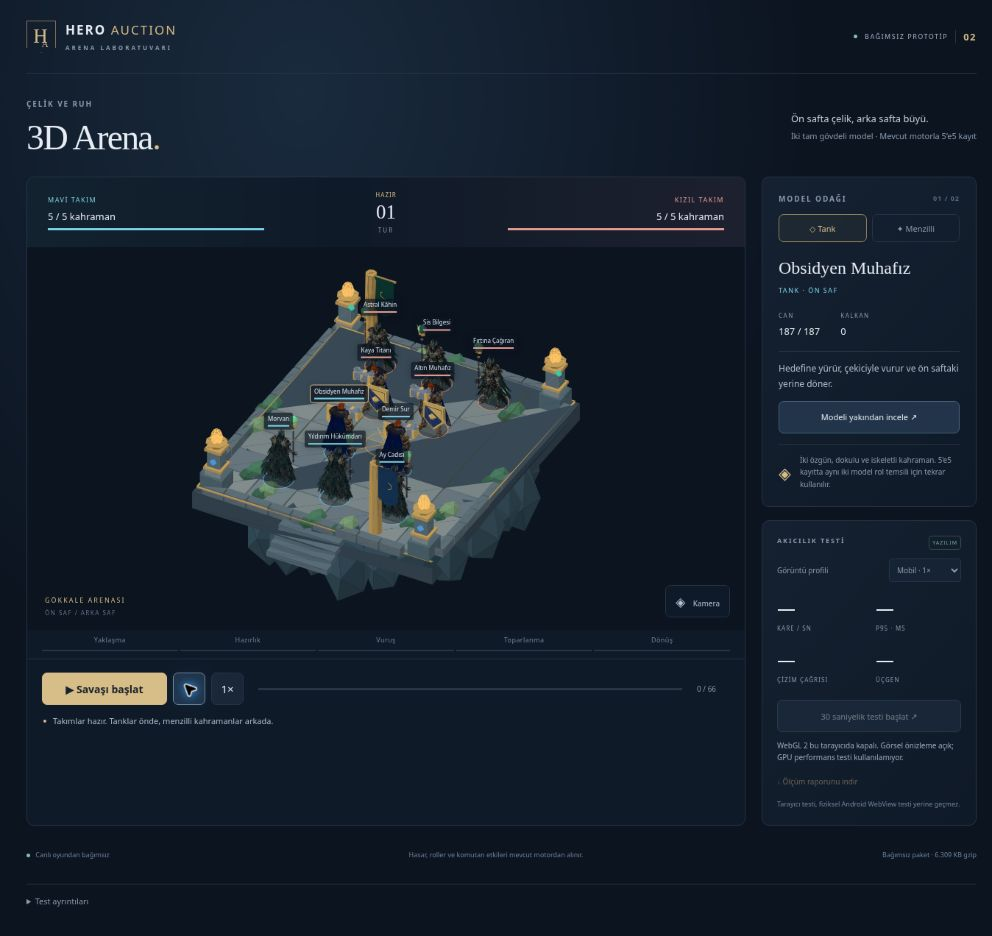

# Hero Auction — dokulu ve iskeletli 3D arena, aşama 1

30 Ekim 2026. Motor temeli: `main@7714fe314ab4e923a9a5dea00d7242217d2b7fa0`.
Dal: `feature/arena-3d-prototype-20261030`. Taslak PR: #77. Canlı oyuna bağlanmaz.

Onaylanan görsel yön doğrultusunda Obsidyen ve Morvan için yeni Meshy 7.1 modelleri üretildi. İlk geometrik maketlerin yerine dokulu, iskeletli GLB karakterler ve gerçek yürüyüş/saldırı klipleri kullanılıyor. Çekiç, kalkan, asa, taş arena, bitkiler, bayraklar ve platform kodla oluşturuluyor. Yakın inceleme düğmesi ve üç kamera açısı tam gövdeyi önden/yandan/arkadan incelemeye yarar.

Bu sürüm Magic Chess seviyesinde tamamlanmış bir görsel ürün değildir. İki karakterlik ilk uygulama aşamasıdır. GPU üzerinde sanat kontrolü, giysi/eldeki silah bağlantılarının temizlenmesi, daha ayrıntılı çevre ve gerçek Android ölçümleri açık kalır. Elli kahraman tamamlanmış değildir. 5'e5 test kaydındaki on kimlik, rol temsili olarak bu iki modeli paylaşır.

## Savaş ve animasyon ayrımı

- `public/`, savaş hesaplamaları, kahraman rolleri, komutan kuralları ve canlı yönlendirme değişmedi. Three.js **0.186.1** korunuyor; yeni npm bağımlılığı yok.
- `director.js` yaklaşma → hazırlık → vuruş → toparlanma → dönüş aşamalarını yönetir. Saldırganı ve hedefi motorun olayından alır; hedef arama, hasar hesaplama veya yeni komutan mantığı içermez.
- Tank kayıttaki hedefe yürür ve safına döner; menzilli karakter yerinde büyü yollar. Hasar/şifa/kalkan ve ölüm, motorun %50 temas sınırındaki anlık görüntüsünden uygulanır. Atlanan saldırı hareket veya mermi üretmez.
- `replay.json`, mevcut motor ve komutan modüllerinin ürettiği 66 karelik sabit 5'e5 kayıttır. Sonuç, farklı kare hızlarında aynıdır. Tarayıcı yeni savaş sonucu üretmez.
- `CharacterMotion`, GLB kliplerini Three.js AnimationMixer ile örnekler; yatay root motion kaldırılır, animasyonlar harmanlanır. Bekleme pozu koda aittir. Tankın darbe tepkisi klipten, Morvan'ın tepkisi ve iki modelin ölüm eğilmesi görsel dönüşümlerden gelir. Pelerin zincirinin bind yönü korunur; kumaş fiziği değildir.
- İleri savaş motoruna geçiş için bu sunum katmanı hazır bir ayrım sağlar. Eşzamanlı bağımsız saldırı, yol bulma ve yeni menzil/denge kuralları bu çalışmada uygulanmadı.

## Model ve boyut bilgisi

| Model | GLB üçgeni | İskelet eklemi | Mobil GLB |
| --- | ---: | ---: | ---: |
| Obsidyen | 30.929 | 77 | 5.357.580 bayt |
| Morvan | 31.095 | 79 | 5.139.836 bayt |

Meshy çıktıları Ultra 2K geometri, 4K doku ve A-pose ile üretildi, 30K üçgen hedefine yeniden ağ oluşturuldu ve Humanoid/Mixamo iskeletine bağlandı. Kaynaklar, hash'ler, klipler ve doku boyutları `assets/manifest.json` içinde bulunur. Dışa aktarılan tank ana dosyası 62.744.616, Morvan 63.859.180 bayttı; yüksek çözünürlüklü sürümler Meshy çalışma alanında durur.

`tools/pack-mobile3d-model.py` Pillow kullanarak gömülü temel renk dokusunu 1024, normal/metallic-roughness dokularını 512 boyutuna indirir. UV, geometri, iskelet ve klip verisini korur; kaynak dosyayı değiştirmez. Mobil GLB'ler depoda hazırdır, olağan derleme Pillow gerektirmez.

Paket yaklaşık **13,01 MB açılmış / 6,46 MB gzip toplamıdır**. Kesin baytlar ve her dosyanın hash'i derlemedeki `build-info.json` içindedir. Bu, eski dokusuz prototipin yaklaşık 0,45 MB gzip toplamından büyüktür. GLB'ler yalnızca bu ayrı önizleme tarafından yüklenir. Gerçek APK/AAB büyümesi ölçülmedi; gzip toplamı APK farkı veya kurulum boyutu değildir. 50 karakteri aynı anda paketleme/yükleme politikası henüz kurulmadı.

## Çalıştırma ve kontroller

```sh
npm ci --ignore-scripts --no-audit --no-fund
npm run test:arena-mobile3d
python3 tools/test-android-package-size.py
npm run build:arena-mobile3d
```

Build çıktısı `.artifacts/mobile3d/` altındadır; statik HTTP sunucusuyla açılmalıdır. Alternatif hedef: `node tools/build-arena-mobile3d.mjs /absolute/output/directory`. Derleme canlı dağıtım yapmaz. CI ilgili PR/dal değişikliklerinde testleri çalıştırıp önizleme paketini Actions artifact olarak saklar.

Doğrulama sonuçları:

- Mevcut tam test paketi: **2625/2625 geçti**, hata veya atlama yok; Node 24.22.1, yaklaşık 26,0 sn. Proje/CI hedefi olan Node 26.12.1 değiştirilmedi.
- Yeni sürümün son özel koşusu: **15/15 geçti**. 15/30/60/120 FPS, büyük kare aralığı, duraklat/reset, saf sırası, komutan etkileri, kritik vuruş uçlarında geçerli şifa çağrısı ve aynı nihai HP/kalkan/sonuç doğrulanıyor.
- Gerçek GLB geometri/UV/iskelet/klip verisi Node'da ayrıştırılıp animasyonla deforme ediliyor. Bağımsız iskeletler, sabit yatay kök, sonlu animasyon sınırları, üçgen bütçesi, kaynak havuzları ve disposal kontrol ediliyor. Node testi görüntü kod çözücüsü içermez; doku kalitesi testi değildir.
- APK/AAB karşılaştırma aracının sentetik arşiv testleri: **2/2 geçti**.
- Bulut tarayıcısında yazılım görünümü, yakın model seçimi, kamera ve oynatma kontrol edildi. Bu tarayıcı WebGL 2 sağlamıyor; GPU render yolu ve fiziksel Android sonuçları henüz doğrulanmadı.

## Android WebView test protokolü

Repo içinde Android projesi/SDK veya bağlı cihaz yok; APK üretilmedi. Mevcut uygulamanın ayrı debug derlemesi kullanılmalı; üretim uygulamasına debug/HTTP izinleri eklenmemeli.

1. Aynı cihazda mevcut 2D arena temel ölçümünü alın. Cihaz, Android/System WebView sürümü, pil/şarj durumu ve çözünürlüğü kaydedin.
2. Statik çıktıyı debug WebView'in geliştirme origin/asset yöntemiyle yükleyin. İlk açılışı temiz cache ile ve tekrar açılışı sıcak cache ile deneyin. Modellerin yüklenmesini bekleyin; rapor `readyMs` değerini içerir ve cache durumunu garanti etmez.
3. `WEBGL 2` modunda Mobil ve Dengeli profillerinin her biri için üçer 30 saniyelik test yapıp JSON indirin. 3 saniye ısınma vardır. Yakın model görünümü benchmark başında kapatılır; tüm takım ölçülür.
4. En az iki düşük/orta sınıf Android cihazda dikey/yatay testleri yapın; 5 dakika oynatma sonrası tekrar edin. Masaüstü veya mobil boyutlu iframe fiziksel WebView'in yerine geçmez.
5. Duraklat/devam, hız, kamera, yakın inceleme, 20 tekrar, ana ekrana git/dön ve kilitle/aç deneyin. Arka plana geçiş, ekran yönü, profil veya context loss sırasında benchmark geçersiz sayılmalıdır.
6. DevTools ile JS heap, uzun görevler, GPU izi ve bellek eğilimini inceleyin. Geometri/doku adetleri tam GPU belleği ölçümü değildir. Pelerin, eller ve silah temasını GPU görüntüsünde özellikle kontrol edin.
7. Aynı imza, ABI, build ve minify ayarlarıyla temel/aday APK veya AAB'yi üretip karşılaştırın. Aşağıdaki 8 MiB sınırı bu iki modelli deneme için başlangıç önerisidir:

```sh
python3 tools/compare-android-package.py baseline.apk candidate.apk --max-growth-bytes 8388608 > apk-delta.json
```

Araç arşiv ve açılmış entry boyutlarını, asset büyümesini ve dosya farklarını raporlar. AAB boyutu Play'in cihaza indirdiği split APK boyutu değildir; kurulu depolama ayrıca ölçülmelidir.

| Ölçüm | Prototip kabul hedefi |
| --- | --- |
| FPS | ≥45 |
| P95 kare aralığı | ≤33,34 ms |
| 33,34 ms üzeri kareler | ≤%5 |
| Çizim çağrısı | ≤180/kare |
| Üçgen | ≤400.000/kare; eski 35.000 sınırı dokulu modellerle yenilendi |
| Mobil | DPR ≤1; ≤900.000 framebuffer pikseli |
| Dengeli | DPR ≤1,5; ≤1.600.000 framebuffer pikseli |
| Dağıtım bütçesi | ≤15 MB açılmış; ≤9 MB dosya başına gzip toplamı |

Geometri/doku başlangıç/son/tepe adetleri, P50/P95/P99, uzun görevler ve yüklenme süresi de raporlanır. Bunlar hedeflerdir, cihazda sağlandığı iddia edilmez. GPU süresi, sıcaklık ve enerji panelden ölçülmez. Rapor sunucuya gönderilmez.

GPU yolunda ortak doku/geometri, ayrı iskeletler, instanced çevre, 128 boyutlu prosedürel PBR ortamı, 12 darbe/16 yazı havuzu ve DPR sınırı kullanılır. Gölge haritası veya post-processing yoktur. WebGL yoksa gerçek iskeletli geometri yazılımla çizilir, `YAZILIM` rozeti görünür ve GPU benchmark kapatılır. Bu görünüm GPU görsel kalitesini veya Android akıcılığını temsil etmez.



## Local camera follow-up (not published)

Camera controls add mouse/touch drag orbit, two-finger pinch, mouse wheel and a dedicated reset. The existing three presets and close model view remain; preset changes clear manual orbit/zoom. Arrow keys rotate, +/- zoom and Home/0 reset the manual offset (the visible reset also returns to preset one). Elevation and orthographic zoom are bounded. Gestures are attached only to the canvas, not buttons or labels; the surrounding page remains scrollable outside the canvas. Ctrl-wheel browser zoom is not intercepted.

A tap selects, while a drag exceeding 7 CSS pixels, cancellation, lost capture or multi-touch never selects. Camera controls are disabled during benchmarks and cancelled on background/page interruptions. There is no automatic orbit, cinematic motion or inertia, including reduced-motion mode. Existing reduced-motion character behavior is preserved. Off-canvas labels are hidden; visible labels are edge-clamped. Full overlap/geometry-occlusion layout is deferred.

This patch changes presentation only, not combat, targeting, model assets, authority, wallet logic or live routing. Local Node checks are not physical-device/GPU validation. Browser gesture/camera art QA must run through the permitted isolated CI or an authorized GPU-enabled preview; no local browser/socket attempt is made where that route was previously denied.

### Citadel environment follow-up

The local follow-up deepens the platform into three stepped structural layers with perimeter buttresses, bevelled stone blocks and two opposing arched entrance monuments. Broad forms and an unobstructed central floor are favored over additional small decorations. A deterministic 64px stone grain and shared 32px soft character contacts provide grounding on the GPU path; no external art or paid generation is used. Nearby entrance masonry fades at low camera angles and disables depth writing while faded. Framing includes the monuments and lower platform from all preset angles. Both existing mobile/balanced DPR limits remain unchanged; there are no new post-processing or shadow-map passes.

Software-only inspection uses the existing triangle renderer offline without a browser or socket: front/cross, side and rear environmental silhouettes were reviewed. It does not demonstrate PBR texture quality, translucent GPU ordering, actual touch interaction, physical FPS or the complete fighting scene. The fallback deliberately omits the new data textures and uses the existing simple contact disks; geometry layering is corrected for floor-over-foundation ordering. Full GPU visuals and environmental occlusion with ten animated heroes must be checked in isolated browser CI and on an authorized physical device before release. Existing signed/native packages and live routing remain untouched.
